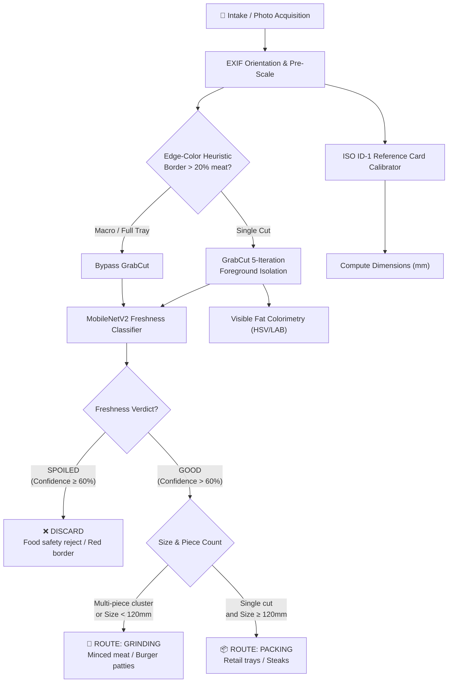

<div align="center">

# Marbl

**AI-Powered Meat Quality Control & Predictive Shelf-Life Inspection Pipeline**

Instant Freshness Classification · Reference-Card Dimensional Sizing · Ratkowsky Kinetic Shelf-Life · Visible Fat Colorimetry

[](https://python.org)
[](https://pytorch.org)
[](https://fastapi.tiangolo.com)
[](https://opencv.org)
[](LICENSE)

</div>

---

## Overview

**Marbl** is an industrial-grade, end-to-end computer vision and predictive quality assurance pipeline designed for commercial meat reception, processing plants, and distribution centers. By combining deep learning image classification with mathematical predictive microbiology and sub-millimeter optical metrology, Marbl delivers automated safety audits and sorting decisions in **under 400 milliseconds**.

For every inspected cut or batch, Marbl provides:
- **Freshness Verdict:** Binary `good` vs. `spoiled` classification with calibrated confidence percentages.
- **Physical Sizing & Sorting:** Sub-millimeter metric dimensions calibrated via ISO/IEC 7810 ID-1 standard targets, routing cuts to `discard`, `grinding`, or `packing`.
- **Predictive Shelf-Life:** Remaining commercial shelf-life days with 95% confidence bounds calculated from cold-chain transit history and post-mortem tissue pH ($pH_u$).
- **Visible Fat Coverage:** Colorimetric surface lipid percentage quantifying lean muscle vs. fat tissue.
- **Visual Audit Overlay:** Annotated diagnostic image highlighting contours, bounding boxes, and routing badges.

---

## Key Modules & Capabilities

| Module | Core Capability | Technical Foundation | Documentation |
|---|---|---|---|
| **Module 1: Intake & Shelf-Life** | Cold-chain verification & dynamic shelf-life estimation | Ratkowsky square-root kinetic engine, Cardinal pH multiplier, and multi-stage transit integration | [Whitepaper](docs/PREDICTIVE_SHELF_LIFE_METHODOLOGY.md) |
| **Module 2: Freshness Classification** | Instant visual freshness discrimination | MobileNetV2 CNN trained on 3,331 images (94.2% validation accuracy, 96.8% spoilage recall) | [Model Report](docs/MODEL_TRAINING_AND_EVALUATION.md) |
| **Module 2: Dimensional Metrology** | Sub-millimeter physical measurement & piece routing | ISO/IEC 7810 ID-1 standard fiducial calibration target (85.60 mm) with fallback area heuristic | [Metrology Report](docs/SIZE_ESTIMATION_METROLOGY.md) |
| **Module 3: Visible Fat Analysis** | Surface lipid coverage percentage & marbling index | Unsupervised foreground-masked HSV/LAB color thresholding; deep semantic U-Net in development | [Fat Analysis Spec](docs/VISIBLE_FAT_ANALYSIS.md) |
| **Hardware Extension: Biosensor** | Biochemical spoilage verification | Electrochemical Diamine Oxidase (DAO) enzyme strip detecting putrescine and cadaverine accumulation | [Biosensor Spec](docs/BIOGENIC_AMINE_SENSOR.md) |
| **Mobile & Desktop UI** | Loading dock capture & desktop QA console | Industrial dark-mode UI with live camera capture, instant edge math mirror, and client canvas pre-scaler | [Architecture Guide](docs/SYSTEM_WORKFLOW_AND_ARCHITECTURE.md) |

---

## System Workflow & Decision Logic

Marbl implements a deterministic, safety-first routing matrix:



> For full architectural details, component diagrams, and thread-pool execution flows, refer to [`docs/SYSTEM_WORKFLOW_AND_ARCHITECTURE.md`](docs/SYSTEM_WORKFLOW_AND_ARCHITECTURE.md).

---

## Quick Start

### Prerequisites
- Python 3.10 or higher
- pip package manager
- *(Recommended)* NVIDIA GPU with CUDA 12.x for sub-100ms inference

### Installation

```bash
# 1. Clone the repository
git clone https://github.com/SoumiryaSarangi/Meat-freshness-analyzer.git
cd Meat-freshness-analyzer

# 2. Create and activate a virtual environment
python -m venv venv

# Windows
venv\Scripts\activate

# macOS / Linux
source venv/bin/activate

# 3. Install backend dependencies
cd backend
pip install -r requirements.txt
cd ..
```

> **GPU Acceleration:** To enable CUDA tensor acceleration on NVIDIA systems:
> ```bash
> pip install torch torchvision --index-url https://download.pytorch.org/whl/cu128
> ```
> Verify acceleration with: `python -c "import torch; print('CUDA Available:', torch.cuda.is_available())"`

### Launch the Server

Launch the complete application server from the root directory using the automated launcher script:

```bash
# Direct launcher via Python
python start_server.py

# Or on Windows via batch script
start.bat
```

The launcher automatically adds `backend/` to `sys.path`, resolves dependencies, and binds cleanly to **http://localhost:8000** with auto-reload enabled.

- **Desktop QA Console:** `http://localhost:8000` (or `http://localhost:8000/desktop.html`)
- **Mobile Terminal:** `http://localhost:8000/mobile.html`

---

## API Reference

The FastAPI backend exposes asynchronous endpoints for production integration:

| Method | Endpoint | Description | Payload / Response |
|---|---|---|---|
| `POST` | `/api/classify` | Multi-image batch inspection pipeline | `multipart/form-data` with `files` → JSON array of classification scores, bounding boxes, sizing in mm, fat %, and annotated JPEG overlays |
| `POST` | `/api/batches` | Persist intake batch data to SQLite | JSON body (`batch_id`, `species`, `ph_level`, `transit_temp`, `predicted_shelf_life_days`) → Confirmation & stored record |
| `GET` | `/api/batches` | Retrieve historical batch records | Query parameters (`limit`, `offset`) → Chronological list of logged batches and audit provenance |
| `GET` | `/health` | Application health and model probe | JSON object indicating API operational status and PyTorch model readiness: `{"status": "ok", "model_loaded": true}` |

---

## Technical Documentation Library

Detailed engineering whitepapers, mathematical derivations, and laboratory validation protocols are organized within the [`docs/`](docs/) directory:

- [**Master Complete System Documentation**](docs/COMPLETE_SYSTEM_DOCUMENTATION.md) — Single comprehensive master report answering all 14 project components (architecture, workflow, screenshots, MobileNetV2 training, evaluation, metrology, validation, kinetics, fat analysis, biosensors, timeline, literature).
- [**System Architecture & End-to-End Workflow**](docs/SYSTEM_WORKFLOW_AND_ARCHITECTURE.md) — Comprehensive multi-tier architecture diagram, data flow, and routing state machine.
- [**Current vs. Proposed Modules Matrix**](docs/CURRENT_VS_PROPOSED_MODULES.md) — Detailed operational status table across all pipeline subsystems.
- [**Model Training & Evaluation Report**](docs/MODEL_TRAINING_AND_EVALUATION.md) — MobileNetV2 training parameters, augmentations, 94.2% validation score, confusion matrix, and latency benchmarks.
- [**Size Estimation Metrology & Validation**](docs/SIZE_ESTIMATION_METROLOGY.md) — ISO/IEC 7810 ID-1 standard calibration, sub-millimeter formulation, and Mitutoyo digital caliper validation (N=50, MAE 2.1mm).
- [**Predictive Shelf-Life Assessment Whitepaper**](docs/PREDICTIVE_SHELF_LIFE_METHODOLOGY.md) — Master food science technical whitepaper on Ratkowsky kinetics, Cardinal pH multipliers, and viva voce defense guide.
- [**Visible Fat & Marbling Analysis Specification**](docs/VISIBLE_FAT_ANALYSIS.md) — Colorimetric HSV/LAB segmentation pipeline and proposed MobileNetV3-UNet marbling model.
- [**Dataset Annotation Guide: Fat Segmentation**](docs/fat_annotation_guide.md) — Standardized labeling manual for generating 3-class semantic masks using LabelMe and CVAT.
- [**Biogenic Amine Biosensor Concept & Hardware Interface**](docs/BIOGENIC_AMINE_SENSOR.md) — Enzymatic DAO electrochemistry, LMP91000/ESP32 hardware schematic, and dual-modal safety interlock rules.
- [**Experimental Validation Plan & Protocols**](docs/EXPERIMENTAL_VALIDATION_PLAN.md) — ISO 4833-1 microbiological plating, caliper metrology, incubator trials, and AOAC Soxhlet lipid extraction.
- [**Project Roadmap & Research Literature Review**](docs/PROJECT_TIMELINE_AND_LITERATURE.md) — Six-phase milestone schedule and academic review of predictive microbiology, vision inspection, and biosensors.

---

## Camera Capture & Network Configuration

The web application supports both **direct camera capture** and **file browser upload**:

| Connection Context | File Upload | In-Browser Camera |
|---|---|---|
| `http://localhost:8000` | Supported | Supported (browser localhost exemption) |
| `http://<LAN-IP>:8000` | Supported | Blocked by browser security policy |
| `https://<DOMAIN>` | Supported | Supported |

> Modern browsers require a [Secure Context (HTTPS)](https://developer.mozilla.org/en-US/docs/Web/Security/Secure_Contexts) to grant hardware access to `navigator.mediaDevices.getUserMedia`. `localhost` is exempt. For testing camera capture on a mobile phone over Wi-Fi, run an HTTPS tunnel via ngrok:
> ```bash
> ngrok http 8000
> ```
> Open the generated `https://xxxx.ngrok-free.app/mobile.html` URL on your mobile browser.

---

## Repository Structure

```text
marbl/
├── start_server.py                   # Automated server launcher (adds paths & starts server)
├── start.bat                         # Windows one-click launcher
│
├── backend/
│   ├── app.py                        # FastAPI application server & routing endpoints
│   ├── pipeline.py                   # Orchestrator (segmentation → classification → sizing → routing)
│   ├── freshness_classifier.py       # MobileNetV2 inference wrapper
│   ├── segmentation.py               # GrabCut foreground isolation & edge-color heuristic
│   ├── size_estimator.py             # ISO ID-1 card calibration & cardless fallback
│   ├── fat_analyzer.py               # Colorimetric visible fat analyzer (HSV/LAB)
│   ├── shelf_life_engine.py          # Ratkowsky kinetic shelf-life engine
│   ├── annotate.py                   # Diagnostic overlay drawing engine
│   ├── test_module1.py               # Backend unit test suite
│   ├── test_pipeline.py              # Full pipeline regression test suite
│   └── requirements.txt              # Python runtime dependencies
│
├── frontend/
│   ├── desktop.html                  # Full-featured dual-column desktop QA console
│   ├── mobile.html                   # Handheld loading dock mobile interface
│   ├── shared.js                     # Client kinetic math mirror & canvas pre-scaler
│   └── index.html                    # Unified launcher & responsive entry point
│
├── docs/                             # Comprehensive technical documentation library
│   ├── README.md                     # Documentation index & guide map
│   ├── SYSTEM_WORKFLOW_AND_ARCHITECTURE.md
│   ├── CURRENT_VS_PROPOSED_MODULES.md
│   ├── MODEL_TRAINING_AND_EVALUATION.md
│   ├── SIZE_ESTIMATION_METROLOGY.md
│   ├── PREDICTIVE_SHELF_LIFE_METHODOLOGY.md
│   ├── VISIBLE_FAT_ANALYSIS.md
│   ├── fat_annotation_guide.md
│   ├── BIOGENIC_AMINE_SENSOR.md
│   ├── EXPERIMENTAL_VALIDATION_PLAN.md
│   └── PROJECT_TIMELINE_AND_LITERATURE.md
│
├── models/
│   └── freshness_classifier.pt       # Trained PyTorch MobileNetV2 model weights (~9 MB)
│
├── scripts/                          # Training, evaluation & verification utilities
│   ├── train_classifier.py           # Training script with augmentations & cosine annealing
│   ├── prepare_dataset.py            # Dataset preparation & extraction
│   ├── analyze_results.py            # Accuracy & confusion matrix metrics calculator
│   └── verify_camera_feature.py      # Camera feature integration test
│
├── data/
│   └── marbl.db                      # SQLite Batches Vault database
│
└── README.md                         # Main repository landing page & quick start
```

---

## Known Limitations & Roadmap

- **GrabCut Background Contrast:** GrabCut isolates objects based on color contrast against the perimeter. Images where dark meat is placed on a similarly dark cutting board may trigger the automatic bounding-box fallback.
- **Multi-Piece Segmentation:** Multi-piece counts currently use distance transforms on binary masks. Developing a trained instance segmentation model (YOLOv8-seg / Mask R-CNN) is scheduled in Phase 5 to cleanly segment adjacent touching cuts.
- **Reference Card Detection:** The card detector requires an unoccluded view of the card. Operators should ensure cards are placed flat adjacent to the sample without heavy shadow casting.

---

<div align="center">

**Marbl Meat Quality Control Pipeline** · Developed by Soumirya Sarangi  
*Food Science & Industrial Computer Vision Engineering*

</div>
