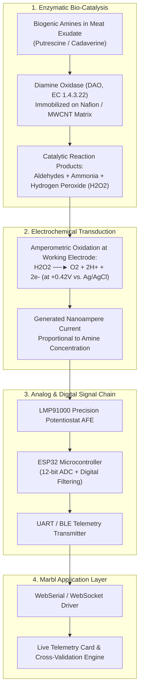

# Biogenic Amine Biosensor Concept & Hardware Integration

**Project:** Marbl — AI Meat Quality Control & Predictive Shelf-Life Inspection Pipeline  
**Document:** Electrochemical Sensor Concept & Telemetry Interface Specification  

---

## 1. Biochemical Sensing Principle

While optical computer vision captures surface reflectance and macroscopic color degradation, anaerobic bacterial catabolism begins deep within muscle tissue prior to visible surface discoloration. Microorganisms decarboxylate amino acids, producing toxic biogenic amines:

- **Ornithine Decarboxylation** $\longrightarrow$ **Putrescine** ($\text{1,4-diaminobutane}$)
- **Lysine Decarboxylation** $\longrightarrow$ **Cadaverine** ($\text{1,5-diaminopentane}$)

Marbl incorporates an electrochemical biosensor interface to monitor amine accumulation quantitatively.



### 1.1 Stoichiometric Reaction Equations
1. **Enzymatic Oxidation:**
   $$\text{R-CH}_2\text{-NH}_2 + \text{O}_2 + \text{H}_2\text{O} \xrightarrow{\text{DAO}} \text{R-CHO} + \text{NH}_3 + \text{H}_2\text{O}_2$$
2. **Anodic Decomposition:**
   $$\text{H}_2\text{O}_2 \xrightarrow{+0.42\text{V vs. Ag/AgCl}} \text{O}_2 + 2\text{H}^+ + 2e^-$$
3. **Current-Concentration Relationship:**
   $$I_{\text{peak}} = k \cdot [\text{Amine}]_{\text{tissue}} + I_{\text{background}}$$

---

## 2. Hardware Architecture & Strip Specifications

### 2.1 Sensor Strip Physical Layout
The sensing interface is built around a single-use, screen-printed three-electrode strip (SPCE):
- **Working Electrode (WE):** Gold/carbon composite modified with multi-walled carbon nanotubes (MWCNT) and glutaraldehyde cross-linked Diamine Oxidase.
- **Reference Electrode (RE):** Screen-printed $\text{Ag/AgCl}$ ink providing a stable electrochemical potential baseline.
- **Counter Electrode (CE):** Carbon graphite ink completing the electrolytic cell.
- **Form Factor:** $10\text{ mm} \times 35\text{ mm} \times 0.5\text{ mm}$ PET substrate with gold-plated card-edge connector pins.

```
       ┌──────────────────────────────┬────────────┐
       │   Screen-Printed Electrodes   │ Contact    │
       │  ┌───┐  ┌───┐  ┌──────────┐  │ Gold Pins  │
       │  │WE │  │RE │  │    CE    │  │ [WE]       │
       │  │DAO│  │Ag │  │  Carbon  │  │ [RE]       │
       │  └───┘  └───┘  └──────────┘  │ [CE]       │
       └──────────────────────────────┴────────────┘
```

### 2.2 Analog Front-End & Controller
- **Potentiostat IC:** Texas Instruments **LMP91000** configurable analog front-end (AFE) for electrochemical sensing:
  - Internal zero set at $50\%$ of supply voltage.
  - Cell bias set to $+0.42\text{ V}$.
  - Programmable transimpedance amplifier (TIA) gain ($2.75\text{ k}\Omega$ to $350\text{ k}\Omega$).
- **Microcontroller:** Espressif **ESP32** (dual-core 240MHz, onboard 12-bit ADC, UART, and Bluetooth Low Energy 5.0).

---

## 3. Telemetry Protocol & Dashboard Integration

### 3.1 UART / BLE Data Packet Format
The firmware samples current at $10\text{ Hz}$, averages over a $1\text{ second}$ sliding window, and transmits telemetry packets at 115200 baud:

```json
{
  "device_id": "DAO-SN-0482",
  "status": "ONLINE",
  "potential_v": 0.420,
  "current_na": 142.5,
  "temperature_c": 18.2,
  "amine_index": 12.4,
  "threshold_limit": 40.0,
  "alert": "NORMAL"
}
```

### 3.2 Dual-Modal Safety Verification Matrix
Marbl fuses optical computer vision predictions with biosensor telemetry to eliminate false-negative food safety escapes:

| Optical Freshness Scan | Biosensor Amine Index | Final Action | Rationale |
|---|---|---|---|
| **GOOD** | $\le 40\text{ mg/kg}$ (Normal) | **APPROVE (Packing / Grinding)** | Both optical and biochemical tests verify freshness. |
| **GOOD** | $> 40\text{ mg/kg}$ (Elevated) | **HOLD & AUDIT (Secondary Test)** | **Safety Interlock**: Early anaerobic spoilage detected before surface discoloration. Product held for laboratory confirmation. |
| **SPOILED** | Any value | **REJECT (Discard)** | Optical discoloration indicates spoilage; product discarded regardless of sensor value. |
| **SPOILED** | $> 40\text{ mg/kg}$ (Elevated) | **REJECT (Discard)** | Conclusive double-positive spoilage confirmation. |
