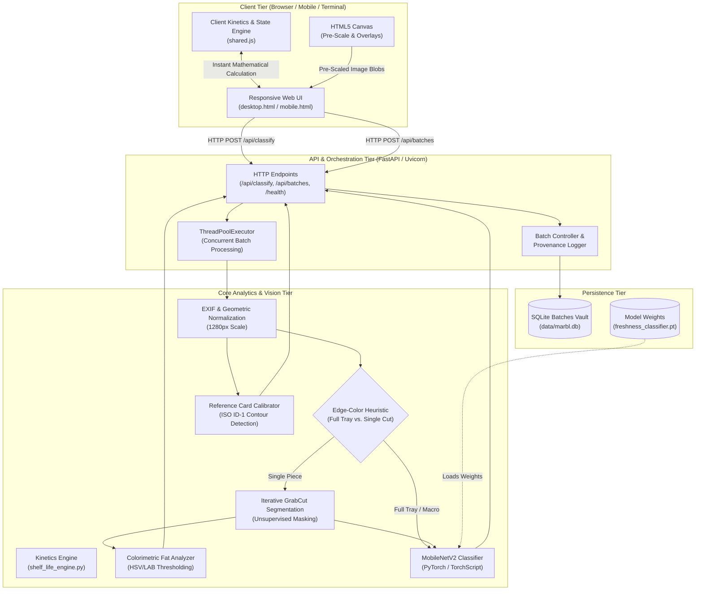
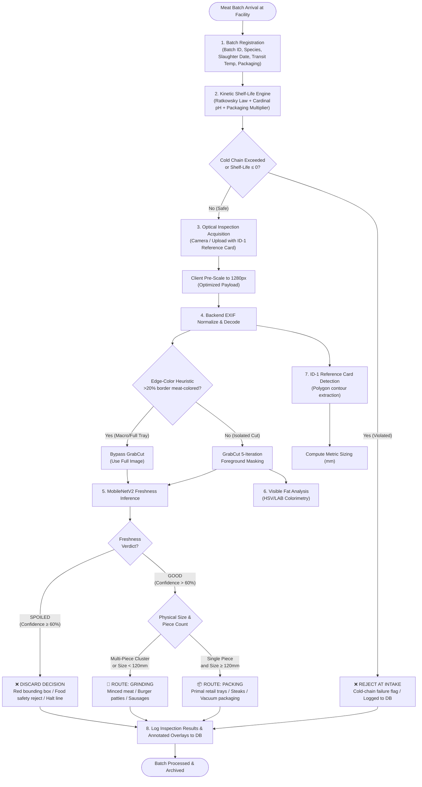

# System Architecture & End-to-End Workflow

**Project:** Marbl — AI Meat Quality Control & Predictive Shelf-Life Inspection Pipeline  
**Document:** System Architecture & Workflow Specification  

---

## 1. System Architecture Overview

Marbl is designed as a decoupled, high-performance system connecting the edge browser interface, an asynchronous FastAPI application server, computer vision pipelines, deep learning inference engines, and persistent SQLite database storage.

### Architectural Tier Breakdown

1. **Client Tier (`frontend/`)**:
   - **`desktop.html`**: Dual-column industrial interface for desktop workstations and fixed QA desks. Incorporates real-time intake kinetics, the industrial viewfinder dropzone, and inspection results.
   - **`mobile.html`**: Handheld terminal view designed for loading docks and cold stores, featuring camera-first capture, batch registration, and touch-optimized results.
   - **`shared.js`**: Shared client-side library containing the interactive Ratkowsky kinetic shelf-life engine, client-side canvas pre-scaler (`optimizeImageForUpload`), and API communication helpers.

2. **API & Orchestration Tier (`backend/app.py`)**:
   - Built on **FastAPI** with ASGI runner **Uvicorn**.
   - Asynchronous request handling with thread pool delegation (`ThreadPoolExecutor`) for CPU/GPU-bound computer vision tasks.
   - Endpoints:
     - `POST /api/classify`: Multi-image batch inspection.
     - `POST /api/batches`: Batch provenance and intake logging.
     - `GET /api/batches`: Historical audit trail retrieval.
     - `GET /health`: Liveness probe and PyTorch model status.

3. **Core Analytics & Vision Tier**:
   - **`shelf_life_engine.py`**: Server-side Ratkowsky square-root microbial growth model with Cardinal pH multipliers and packaging atmosphere inhibition factors.
   - **`segmentation.py`**: Unsupervised GrabCut background isolation with edge-color heuristic safeguarding against macro tray over-segmentation.
   - **`freshness_classifier.py`**: MobileNetV2 convolutional neural network delivering binary freshness decisions (`good` vs. `spoiled`) with calibrated confidence scores.
   - **`size_estimator.py`**: Sub-millimeter metric estimation using ISO/IEC 7810 ID-1 reference card calibration targets, with automatic area fallback when no card is present.
   - **`annotate.py`**: Visual annotation renderer drawing bounding boxes, status pills, and dimensions on output images.

4. **Persistence Tier (`data/marbl.db`)**:
   - SQLite relational store logging batch identifiers, species, slaughter timestamps, cold-chain profiles, predicted shelf-life days, and visual inspection summaries.

---

## 2. End-to-End System Workflow & Decision Logic

The complete inspection journey follows a deterministic, food-safety-first pipeline from initial meat arrival to final disposition.

### Decision Logic Rules

| Output Class | Condition | Downstream Operational Action |
|---|---|---|
| **DISCARD** | MobileNetV2 `spoiled` verdict OR confidence on `good` < 60% | Meat is rejected immediately. Red bounding box displayed. Product is diverted to inedible waste or rendering. |
| **GRINDING** | Freshness is `good`, AND (longest dimension < 120 mm OR multi-piece cluster detected) | Meat is high quality but too small or irregular for retail steak trays. Routed to grinding line for mince, burgers, or sausage production. |
| **PACKING** | Freshness is `good`, longest dimension ≥ 120 mm, and single cut | Prime cut meeting retail specifications. Routed to automated tray wrapping, vacuum skin packaging, or prime labeling. |

